<!-- ───────────── HEADER ───────────── -->

  

<!-- ───────────── BADGES ───────────── -->

  
  &nbsp;
  
  &nbsp;
  

<!-- ───────────── SOCIALS ───────────── -->

  &nbsp;
  &nbsp;
  &nbsp;
  &nbsp;
  

 

<!-- ───────────── WHOAMI ───────────── -->

  

 

<!-- ───────────── QUESTS ───────────── -->
## &nbsp;Active quests

  ✦ &nbsp;<a href="https://undrift.anik8.me"><b>Undrift</b></a> &nbsp;<i>(main quest · in progress)</i> —
  Self-healing observability for APIs you don't control.

  ✦ &nbsp;<b>Kyte</b> &nbsp;<i>(Top 160 · Singapore India Hackathon 2026)</i> —
  UPI → PayNow cross-border payments.

  ✦ &nbsp;<b>AI voice receptionist</b> &nbsp;<i>(built)</i> —
  24/7 voice agent that answers calls and books appointments.

  ✦ &nbsp;<b>AI website builder</b> &nbsp;<i>(stealth)</i> —
  Build sites from a prompt. More soon.

 

<!-- ───────────── LEARNING IN PUBLIC ───────────── -->
## &nbsp;Learning in public

  ✦ &nbsp;<a href="https://github.com/anik8-codes/cloud-devops-zero-to-100"><b>cloud-devops-zero-to-100</b></a> —
  144 curated resources, a 100-day roadmap, projects and outage stories.

  ✦ &nbsp;<a href="https://github.com/anik8-codes/kube-from-zero"><b>kube-from-zero</b></a> —
  Kubernetes from scratch: notes, diagrams, configs and a 4-node kind cluster.

  ✦ &nbsp;<b>Open source</b> —
  <a href="https://github.com/wagtail/wagtail">Wagtail</a> · <a href="https://github.com/asyncapi/website">AsyncAPI</a> · <a href="https://github.com/CodeForGoodTech/C4GT">C4GT</a> · <a href="https://github.com/Alchemyst-ai/aisdk">Alchemyst AI</a>

 

<!-- ───────────── INVENTORY ───────────── -->
## &nbsp;Inventory

  

 

<!-- ───────────── CHARACTER SELECT ───────────── -->
## &nbsp;Character select

  

 

<!-- ───────────── XP LOG ───────────── -->
## &nbsp;XP log

  

  

 

<!-- ───────────── CONNECT ───────────── -->
## &nbsp;Co-op mode

  Up for collabs, ambitious product ideas, and talking DevOps, cloud and AI agents.

  &nbsp;
  &nbsp;
  

 

<!-- ───────────── FOOTER ───────────── -->

  
   
  <b>See you next level.</b>

