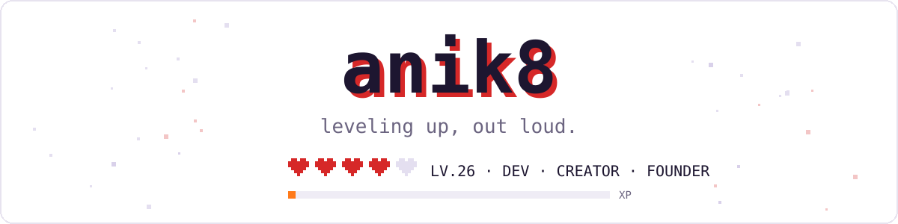
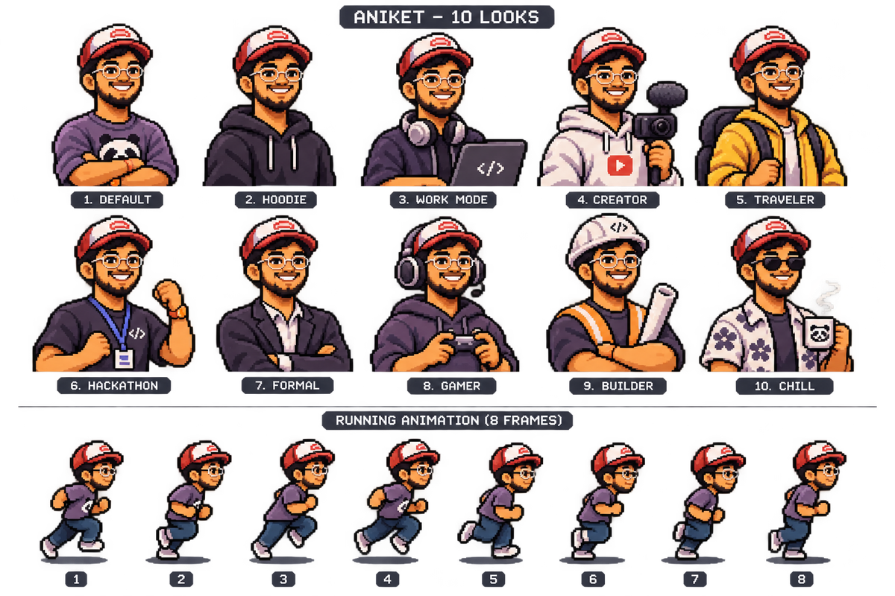

  

  
  
  
  
  

---

### 🎮 Player card

> Hey, I'm **Aniket** — a dev who builds things, finds the best tools, and shares everything I learn along the way.

| | |
|---|---|
| 🧢 **Class** | Full-stack dev · DevOps · AI builder |
| 🏢 **Current guild** | CTO at a startup |
| 📍 **Spawn point** | Indore, India |
| ⚔️ **Main quest** | Shipping [Undrift](https://undrift.anik8.me) |
| 📺 **Side quest** | Teaching DevOps, cloud & system design on [@careerswithaniket](https://instagram.com/careerswithaniket) |
| 💬 **Ask me about** | Kubernetes, AWS, LLM agents, and turning ideas into shipped products |

 

---

### ⚔️ Quests — what I'm building

| Quest | What it is | Status |
|---|---|---|
| 🛰️ **[Undrift](https://undrift.anik8.me)** | Self-healing observability for APIs you don't control | 🟢 In progress |
| 🪁 **Kyte** | UPI → PayNow cross-border payments | 🏆 Top 160, Singapore India Hackathon 2026 |
| 🧱 **AI website builder** | Build sites from a prompt | 🤫 Stealth |
| 📞 **AI voice receptionist** | 24/7 voice agent that answers calls and books appointments | 🛠️ Built |

### 📜 Learning in public

- **[cloud-devops-zero-to-100](https://github.com/anik8-codes/cloud-devops-zero-to-100)** — 144 curated resources, a 100-day roadmap, projects and outage stories
- **[kube-from-zero](https://github.com/anik8-codes/kube-from-zero)** — Kubernetes from scratch: notes, diagrams, configs and a 4-node kind cluster

### 🤝 Open-source contributions

[Wagtail](https://github.com/wagtail/wagtail) · [AsyncAPI](https://github.com/asyncapi/website) · [C4GT](https://github.com/CodeForGoodTech/C4GT) · [Alchemyst AI](https://github.com/Alchemyst-ai/aisdk)

---

### 🧢 Character select

  

---

### 🎒 Inventory

  

Also in the bag: LLMs & agents · vector databases · voice AI · CI/CD · system design · Premiere Pro · After Effects

---

### 📈 XP log

  

  

---

  
   
  <b>See you next level.</b>
    
  
   
  💼 Collabs & work: <a href="mailto:aniketscourses@gmail.com">aniketscourses@gmail.com</a>

